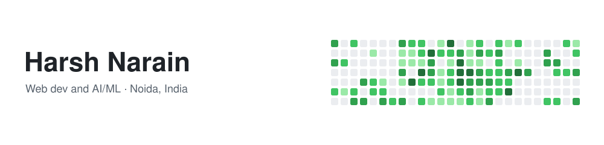

<picture>
  <source media="(prefers-color-scheme: dark)" srcset="assets/header-dark.svg">
  <source media="(prefers-color-scheme: light)" srcset="assets/header-light.svg">
  
</picture>

Computer Science undergrad at Sharda University (B.Tech CSE, '27), based in Noida. I work on front end and on AI/ML, usually in the same project.

### RareSight

RareSight is what I'm building now. It takes a patient's symptoms, written as HPO codes, and ranks about 557 candidate diseases, best match first.

The idea: build a graph connecting symptoms, diseases and genes, then train a graph neural network on it. Patient and disease symptom profiles get compressed into 64-dimensional vectors and ranked by distance. The shortlist can then be reranked by an LLM using retrieved evidence.

### Tools

<picture>
  <source media="(prefers-color-scheme: dark)" srcset="https://skillicons.dev/icons?i=python,javascript,java,mysql,mongodb,redis,pytorch,tensorflow,scikitlearn,opencv,react,nodejs,expressjs,flask,git&theme=dark&perline=15">
  
</picture>

Also Keras, HuggingFace Transformers, Jupyter and Colab.

### Away from the keyboard

I play a lot of FPS and I'm top 1% in most of the ones I take seriously: Valorant, CS:GO, Overwatch, Marvel Rivals, The Finals and Apex Legends. osu! when I want something different. Anime the rest of the time.

### Reach me

